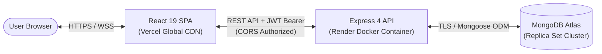

# JobTrackr — Full-Stack Job Application Tracker

JobTrackr is a modern, responsive MERN-stack Kanban application designed to manage and track job applications across every stage of the hiring pipeline. It features JWT-based role authentication, strict owner isolation, live aggregated metrics, optimistic UI updates with rollback, and Docker containerization.

---

## 🌐 Live Production Links

- **Live Frontend (Vercel)**: [https://jobtrackr-app.vercel.app](https://jobtrackr-app.vercel.app) *(Replace with your deployed Vercel domain)*
- **Live API Health Check (Render)**: [https://jobtrackr-api.onrender.com/api/health](https://jobtrackr-api.onrender.com/api/health) *(Replace with your deployed Render domain)*

---

## 👤 Recruiter Demo Accounts

Test the live application immediately with these pre-seeded credentials:

| Role | Email | Password | Access Privileges |
| :--- | :--- | :--- | :--- |
| **Admin** | `alice.johnson@example.com` | `Password123!` | Full Kanban Board + Platform Analytics (`/api/admin/stats`) |
| **User** | `demo@jobtrackr.com` | `Password123!` | Personal Kanban Board + Ownership Isolated Data |
| **User (Alt)** | `bob.smith@example.com` | `Password123!` | Personal Kanban Board + Ownership Isolated Data |

---

## 🏛️ Architecture Overview

JobTrackr uses a decoupled architecture with client-side routing, an Express REST API backend, and cloud database persistence:



1. **Frontend (Vercel)**: React 19 Single Page Application built with Vite and React Router 7. Features optimistic drag-and-drop status movements, query parameter synchronization (`useSearchParams`), and an Axios interceptor for automated session expiry redirection.
2. **Backend (Render)**: Express 4 REST API running on Node.js 20 within a lightweight Alpine Docker container. Hardened with Helmet HTTP security headers, express-rate-limit brute-force protection, and NoSQL injection query sanitization.
3. **Database (MongoDB Atlas)**: Managed document database with compound B-tree indexes (`{ owner: 1, status: 1 }`), schema validation rules, and aggregation pipelines.

---

## 📸 Screenshots & Network Evidence

All screenshots are stored in [`./client/screenshots/`](./client/screenshots/):

- **Kanban Board UI**: [Kanban Board View](./client/screenshots/kanban-board.png)
- **DevTools Network — 200 OK**: [Authenticated Applications Request](./client/screenshots/network-200-get-applications.png)
- **DevTools Network — 401 Unauthorized**: [Expired Session Interception](./client/screenshots/network-401-unauthorized.png)
- **DevTools Network — 400 Bad Request**: [Validation Failure Feedback](./client/screenshots/network-400-validation-error.png)

---

## 💻 Local Setup & Environment Variables

### 1. Environment Variable Reference (No Secret Values)

#### Backend (`Job Tracker/server/.env`)
| Variable Name | Description | Example / Default |
| :--- | :--- | :--- |
| `PORT` | Local HTTP listening port | `5000` |
| `NODE_ENV` | Runtime environment mode | `development` / `production` |
| `MONGODB_URI` | MongoDB Atlas or local connection string | `mongodb+srv://<user>:<password>@cluster.mongodb.net/jobtrackr` |
| `JWT_SECRET` | Cryptographic secret for signing tokens | `<long_random_entropy_string>` |
| `JWT_EXPIRES_IN` | Token time-to-live | `1d` |
| `CLIENT_URL` | Allowed frontend origin for CORS | `http://localhost:5173` |

#### Frontend (`Job Tracker/client/.env`)
| Variable Name | Description | Example / Default |
| :--- | :--- | :--- |
| `VITE_API_URL` | Base URL targeting Express REST API | `http://localhost:5000/api` |

### 2. Local Installation & Startup

```bash
# Clone the repository
git clone https://github.com/your-username/jobtrackr.git
cd jobtrackr

# Start Backend Server
cd server
npm install
npm run seed     # Seeds 1,000 applications and 2 test users
npm run dev      # Runs with Node --watch on port 5000

# Start Frontend Client (in a separate terminal)
cd ../client
npm install
npm run dev      # Serves Vite application on port 5173
```

---

## 📦 Production Build: `dist/` vs. `src/` + `node_modules/`

Running `npm run build` with Vite compiles the application into the `dist/` directory:

- **What Vite Outputs in `dist/`**:
  - `dist/index.html`: Optimized HTML entry point with hashed asset links.
  - `dist/assets/*.js`: Single, minified, tree-shaken JavaScript bundle (~350 kB uncompressed, ~110 kB gzipped).
  - `dist/assets/*.css`: Bundled, minified CSS stylesheet (~10 kB).

- **Why `dist/` is Dramatically Smaller than `src/` + `node_modules/`**:
  1. **Tree-Shaking**: Rollup analyzes static ES module import/export graphs and strips unused functions, classes, and dead code from imported libraries.
  2. **Exclusion of `devDependencies`**: Development tooling (Vite, ESLint, TypeScript types, compilers) present in `node_modules` (~100+ MB) are entirely excluded from client-facing output.
  3. **Minification & Mangling**: Variable identifiers, whitespace, comments, and redundant syntax are compressed into ultra-compact, high-density machine code optimized for CDN caching and rapid browser parse times.

---

## 🐳 Docker & CI/CD Concepts

### Image vs. Container
A Docker image is an immutable, read-only template packaging application code, dependencies, and system runtime libraries.
A container is a lightweight, isolated execution instance created at runtime from an underlying image.
Multiple stateful or stateless containers can be instantiated from a single image across any platform.

### CI vs. CD
Continuous Integration (CI) automatically builds, lints, and tests code changes on every pull request to catch defects early.
Continuous Delivery/Deployment (CD) automatically packages and releases verified build artifacts directly to production infrastructure.
CI guarantees code quality and prevents merge conflicts, while CD eliminates manual deployment overhead and reduces time-to-market.
